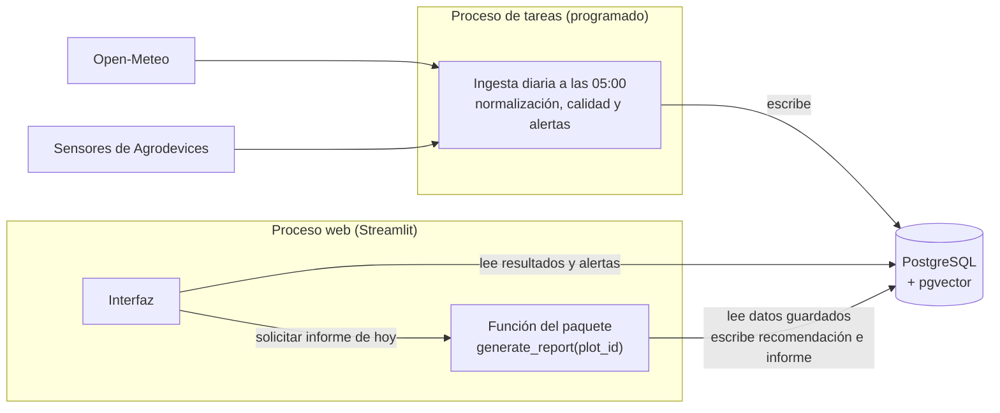
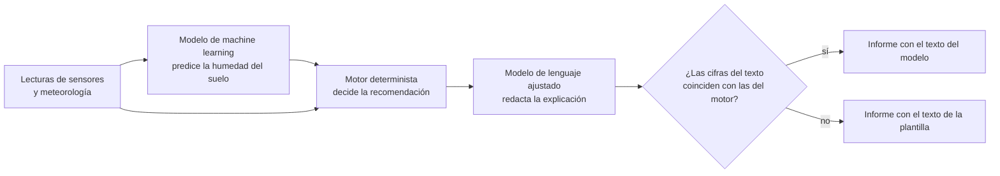

# Arquitectura

Estado a 5 de noviembre de 2026: el esquema de la base de datos, la preparación de datos y la meteorología, la parcela de referencia (`reference_plot.py`) y el **motor de riego** (`irrigation_engine/`, sección 5.2) están construidos. Los demás módulos que se describen aquí (modelo de humedad en producción, informe, web, alertas) están **planificados o en construcción**; esta página solo se ha actualizado en lo que toca al motor y el resto puede estar desfasado.

Cada afirmación de este documento está marcada, cuando importa, como **acordada**, **provisional** (propuesta pendiente de comprobar) o **pendiente** (dato que aún no se conoce). El registro de por qué se decidió cada cosa está en [decisiones.md](decisiones.md).

## 1. Qué se construye

Una plataforma web sencilla para una empresa que fabrica sensores de suelo agrícola (Agrodevices). Combina datos de sus sensores y parcelas con la previsión y el histórico meteorológico de Open-Meteo, para que un agrónomo o una persona de campo entienda **cuánto regar, cuándo y por qué**, a partir de una recomendación calculada y explicable.

Es un Trabajo Fin de Máster con potencial de portfolio y evolución empresarial. Se prioriza la calidad de los datos, el cálculo y la explicación, manteniendo el desarrollo web acotado.

**Alcance (acordado el 14 de octubre de 2026):** el TFM debe aplicar lo aprendido en el máster (machine learning, deep learning e IA generativa), así que los modelos son el centro del proyecto y la aplicación web es el vehículo.
- **Modelo de machine learning clásico** que predice la humedad del suelo, para recomendar riegos de días futuros.
- **Motor determinista de riego explicable**, que decide a partir de esas predicciones.
- **Informes diario y semanal**, con una plantilla como respaldo y con explicaciones redactadas por un **modelo de lenguaje ajustado** (fine-tuning) e integrado, de forma automática. El MVP debe poder generar la recomendación en **PDF descargable, con gráficas y explicaciones en lenguaje natural**.
- **Alertas agronómicas** (lluvia fuerte prevista, suelo muy seco).
- **Acceso de usuarios a sus parcelas.**

**Opcional, si da tiempo:** corrección del sesgo de la previsión meteorológica.
**Fuera del MVP:** detector de anomalías en los sensores (mejora futura).
**Descartado:** agente interactivo o chat, que un LLM calcule la dosis y usar un LLM solo con un prompt.

No se accionan válvulas ni se ejecuta riego automáticamente. No se entrena un modelo base desde cero. Los componentes de IA se describen en la sección 5.1.

## 2. Visión general

**Monolito modular (acordado):** un repositorio, un único paquete Python (`irrigation_app`) con toda la lógica, y **dos procesos** que lo comparten. No son microservicios: no se llaman entre sí por HTTP, y solo se comunican a través de la base de datos.

## 3. Los dos procesos

| | Proceso de tareas | Proceso web |
|---|---|---|
| Para qué | Descargar y guardar datos | Consultar y pedir informes |
| Cuándo corre | Una vez al día, a las 05:00 | Cuando el usuario abre la web |
| Descarga datos de proveedores | **Sí** | **Nunca** |
| Ejecuta el motor de riego | No | **Sí, a petición del usuario**, para una parcela |
| Escribe en la BBDD | Previsiones, histórico, lecturas de sensores, alertas, registro de ejecuciones | Recomendaciones, informes y el marcador de alertas vistas |
| Entrena modelos | No (se hace aparte) | No |

**Acordado:**
- Abrir la web consulta resultados guardados y alertas actuales, sin llamar a proveedores, entrenar ni recalcular todo por abrir una página.
- La interfaz **no calcula**: al pulsar "solicitar informe de hoy" llama a una función del paquete (por ejemplo `generate_report(plot_id)`) que ejecuta el motor, guarda la recomendación y el informe y devuelve el resultado. La página solo lee y muestra. Esa función se ejecuta dentro del proceso web, por lo que el usuario de la BBDD de la web necesita permiso de escritura.
- Los cálculos usan los datos guardados a las 05:00. No se descarga nada al pedir un informe; un cambio de unas horas en el tiempo se considera irrelevante para decidir un riego.
- Entrenar modelos se hace aparte; la aplicación usa versiones identificadas.

Las **alertas agronómicas** se generan en la tarea diaria, tras guardar los datos. El detector de anomalías queda fuera del MVP. El texto del LLM lo genera un proceso aparte en el ordenador de Laia (ver sección 5.1).

## 4. Flujos

### 4.1. Tarea diaria (05:00)

1. Descargar la previsión de Open-Meteo para cada parcela y guardarla en `forecast_data`, **sin sobrescribir** lo anterior.
2. Descargar el histórico observado y guardarlo en `historical_weather` (se sobrescribe cuando Open-Meteo revisa los valores).
3. Importar las lecturas de los sensores a `sensor_reading`, con su marca de interpolación (`SMMi` frente a `SMM`). Los datos ya vienen normalizados por la empresa; las tramas originales se quedan allí.
4. Crear o actualizar las alertas agronómicas (lluvia fuerte prevista, suelo muy seco). Sus umbrales están pendientes.
5. Registrar la ejecución en `job_run`: éxito, fallo parcial o fallo, y qué parcelas fallaron.

Una alerta persistente **no se crea de nuevo en cada ejecución**: si ya hay una activa del mismo tipo en la parcela, se actualiza. Un fallo de una parcela no detiene al resto.

### 4.2. Abrir la web

1. Login (sección 7).
2. Se muestran las parcelas del usuario y los últimos resultados guardados, con su fecha.
3. No se descarga nada ni se recalcula.

### 4.3. Solicitar el informe de hoy

1. El usuario pulsa "solicitar informe de hoy" en una parcela suya.
2. La función del paquete comprueba el permiso en el servidor, ejecuta el motor con los datos guardados, y guarda la recomendación (una por parcela y día; si se pide otra vez, se actualiza) y el informe.
3. La página muestra el informe, con un botón para **descargarlo en PDF** (con gráficas y explicaciones en lenguaje natural), y con la **fecha de su recomendación**. Si hoy aún no se ha pedido ninguno, se muestra el último con su fecha, junto al botón de solicitar el de hoy. **Un cálculo antiguo nunca se presenta como actual.**

### 4.4. Cuando falla una actualización

Se muestra el último resultado disponible con su fecha y avisos. Si nunca hubo resultado, se indica que no hay datos suficientes.

## 5. Módulos del paquete (planificados)

Los nombres de carpeta son **orientativos**: se crean en cada fase, no antes. Solo existe `src/irrigation_app/__init__.py`.

| Módulo | Responsabilidad | Estado |
|---|---|---|
| `connectors/` | Open-Meteo y acceso autorizado de solo lectura (o exportaciones) a los datos de Agrodevices | Por crear |
| `ingestion/` | Normalización: identificadores, unidades, fechas, procedencia y validación de estructura | Por crear |
| `storage/` | Consultas y escritura en la BBDD, sin perder las referencias a lo usado | Por crear |
| `alerts/` | Reglas de las alertas agronómicas (lluvia fuerte prevista, suelo muy seco) | Por crear; umbrales pendientes |
| `quality/` | Detector de anomalías por reglas (interpolación frecuente, sensor mudo) | **Fuera del MVP**, mejora futura |
| `models/` | Modelo de machine learning de humedad del suelo: entrenamiento (aparte) e inferencia | Por crear |
| `explanations/` | Modelo de lenguaje ajustado que redacta las explicaciones, y la comprobación de fidelidad de las cifras | Por crear |
| `irrigation_engine/` | Motor de riego FAO-56: entradas, cálculo y resultado, en un mismo paquete (ver 5.2) | **Construido** (5 de noviembre de 2026); falta guardar la recomendación (`storage/`, tarea 6.5) |
| `reports/` | Estadísticas, plantilla diaria y semanal, gráficas y generación del PDF descargable (librería: ReportLab; maquetación por diseñar) | Por crear |
| `access/` | Filtra las parcelas permitidas por usuario y sirve datos a la interfaz | Por crear |
| `jobs/` | Coordina la secuencia diaria, evita ejecuciones concurrentes y duplicados, registra resultados parciales | Por crear |
| `web/` | La interfaz Streamlit | Por crear |

**Acordado sobre el motor:** la entrada (`EngineInput`) es un módulo **dentro** de la carpeta del motor, junto al cálculo y al resultado. Los conectores y los modelos quedan **fuera** y le proporcionan datos y predicciones.

No se inventan columnas, unidades, calibraciones, parámetros ni umbrales: cada cifra de tabla lleva su fuente y, si es un supuesto, se declara como tal.

### 5.1. Componentes de IA (acordado el 14 de octubre de 2026)

El TFM debe aplicar machine learning, deep learning e IA generativa. Se reparte el trabajo en **tres capas**: el modelo **predice**, las reglas **deciden** y el modelo de lenguaje **explica**. Ninguna IA calcula la dosis.

**Por qué una IA no calcula la dosis.** Un LLM falla en la aritmética de varios pasos, puede dar resultados distintos con los mismos datos, no permite demostrar cómo llegó a una cifra y consume muchos más tokens. Además, un modelo supervisado necesitaría ejemplos de la dosis correcta, que no existen. El motor determinista es reproducible, auditable y gratis por cada cálculo.

**Capa 1: predicción de la humedad del suelo (modelo principal, B).**
- **Machine learning clásico** (decisión del 17 de octubre de 2026; el deep learning se aplica en el modelo de lenguaje). Algoritmo concreto por decidir; candidatos: *gradient boosting* o regresión regularizada. Se entrena con las lecturas de los sensores y la meteorología, y alimenta la perspectiva futura del informe semanal.
- Datos: unos 25.000 registros de Agrodevices, de varios sensores y parcelas (por verificar: cuántos sensores, frecuencia y fechas).
- Evaluación: validación temporal (se entrena con el pasado y se evalúa con el futuro, sin que el modelo vea lo que debe predecir) y comparación con baselines: persistencia, regresión sencilla y balance de agua determinista. Un modelo más complejo no tiene por qué ganar a las baselines; la comparación rigurosa es el resultado.
- El entrenamiento se hace **aparte**, en el ordenador de Laia, con versiones identificadas.
- **Pendiente:** arquitectura concreta, ventana de entrada, horizonte de predicción y **dónde se guardan las predicciones**: el esquema actual no tiene una tabla para ellas y probablemente haga falta una.

**Capa 2: el motor determinista** toma la predicción y los parámetros de la parcela y decide la recomendación con las fórmulas de FAO-56 (ver 5.2).

**Capa 3: explicación con un modelo de lenguaje ajustado.**
- *Fine-tuning* de un modelo abierto pequeño con QLoRA en la GPU local (NVIDIA GeForce de 8 GB). Según guías secundarias, en 8 GB caben modelos de 3 a 4 mil millones de parámetros con holgura y de 7 a 8 mil millones muy justos; el modelo concreto, su licencia y su calidad en español están por decidir.
- Integrado y automático: una función recibe el resultado del motor, genera la explicación y la guarda en `report` (`generator` y `generator_version` identifican el modelo). Nadie conversa con él ni le escribe instrucciones.
- **Datos de entrenamiento:** pares "resultado del motor → explicación en español", creados con generación programática más generación con ayuda de una IA, revisando una muestra (idealmente con apoyo agronómico). Debe declararse en la memoria. **Dependencia:** hay que fijar antes la estructura de salida del motor, porque los ejemplos se derivan de ella.
- **Fidelidad:** el modelo genera el texto con huecos (por ejemplo `{net_dose_mm}`) que el código rellena con las cifras del motor, y una comprobación automática verifica que el texto no contradice esas cifras. Si falla, el informe usa la plantilla, que se mantiene siempre como respaldo.
- **Evaluación:** modelo ajustado frente a la plantilla y frente al mismo modelo sin ajustar, con casos reservados solo para evaluar; se miden cifras, unidades, motivos y cómo comunica lo que falta o es incierto.
- **Dónde se ejecuta:** en el ordenador de Laia, en un proceso aparte, sobre recomendaciones ya calculadas. La web, que puede estar en la nube, muestra la plantilla hasta que el texto esté disponible. Para la defensa puede ejecutarse todo en local.

**Corrección del sesgo de la previsión (A), opcional.** Si da tiempo. A un día vista el error probablemente no cambia la dosis; en los días 3 a 7 del informe semanal sí puede importar. Habría que medir cuánto cambia la dosis recomendada al corregirla.

**Conocimiento agronómico con RAG: mejora futura.** Consistiría en buscar fragmentos de documentación técnica (por ejemplo, la guía FAO-56) y dárselos al modelo de lenguaje para apoyar sus explicaciones. Queda fuera del alcance actual porque exige reunir los documentos y comprobar sus licencias, añadir un índice de búsqueda y evaluar que el modelo no mezcle el texto recuperado con las cifras del motor. La alternativa barata es asociar a cada regla del motor un texto explicativo fijo, sacado de una fuente fiable.

### 5.2. Motor de riego FAO-56 (`irrigation_engine/`)

Paquete de Python puro: **función pura** (mismas entradas, mismo resultado), sin red, sin base de datos y sin leer el reloj. Entradas y salidas validadas con Pydantic; un valor imposible se rechaza con un error que nombra el campo y un valor desconocido es `null`.

| Archivo | Qué hace |
|---|---|
| `reference_values.py` | Tablas FAO-56 con la fuente de cada cifra y su estado (`verified` o `assumption`). Un cultivo, una textura o un tipo de riego desconocidos dan `UnknownReferenceError`; nunca se inventa un valor |
| `inputs.py` | `EngineInput`: la parcela (`REFERENCE_PLOT`, contrato C5), las predicciones de humedad por sonda y horizonte (`ml_prediction`, C1), la meteorología prevista por fecha (C3) y, opcional, una eficiencia declarada |
| `calculation.py` | `run_engine(EngineInput) -> EngineResult` y las funciones puras que usa |
| `result.py` | `EngineResult` (contrato C2): plan de 7 días, decisión por día, dosis, estado de validación, factores con su origen, limitaciones y sensibilidad |

**Convención de días.** El día `k` del plan (1 a 7) es la fecha `origen + k` y usa la predicción del horizonte `k`: la humedad de las 05:00 UTC de esa fecha, que el modelo predice **sin riego futuro** y con la meteorología ya dentro. El motor **no** vuelve a sumar la lluvia ni la ET₀ a esa humedad.

**Fórmulas** (en el orden en que se aplican):

1. **Humedad de la zona radicular** = media de las predicciones de las sondas de `average_depths_cm` (en la 1168: 15, 25 y 35 cm; la de 55 cm no interviene). Si falta una sonda, se promedian las demás y el resultado es `provisional` con una limitación que la nombra; si no queda ninguna, el día es `insufficient_data`.
2. **Fracción de agua útil gastada** `D = (A_sup − humedad) / (A_sup − A_inf)`, con los anclajes globales de la escala del sensor (1168: 79,40 y 59,71, de las líneas de Agrodevices confirmadas por Laia). Se recorta a 0–1 y el día lo indica (`depletion_clamped`).
3. **ETc = Kc × ET₀** (FAO-56, ecuación 58). La ET₀ llega de Open-Meteo y no se calcula. El Kc sale de la Tabla 12 (caso de cubierta y heladas) y de la etapa del día, con la curva de FAO-56: Kc ini constante, lineal hasta Kc mid al final del desarrollo, constante, y lineal hasta Kc fin al final de la etapa tardía. Etapas: Tabla 11, «Deciduous Orchard», 20/70/90/30 días (210 en total).
4. **Umbral p** de la Tabla 22 (manzano: 0,50 para ETc ≈ 5 mm/día), ajustado cada día con la nota 2: `p = p_tabla + 0,04 × (5 − ETc)`, entre 0,1 y 0,8. Sin ET₀ queda el valor de tabla.
5. **Decisión del día**, en este orden: fuera de campaña → `do_not_irrigate`; sin predicción de ninguna sonda → `insufficient_data`; ya hay un riego anterior en el plan → `do_not_irrigate` (la predicción «sin riego» ya no vale); `D ≤ p` → `do_not_irrigate`; `D > p` con lluvia prevista ≥ 5 mm ese día (umbral aprobado por Laia el 5 de noviembre de 2026) → `postpone`; `D > p` sin lluvia → `irrigate` (solo el primer cruce).
6. **Dosis** del día de riego (la sonda decide *cuándo*; el criterio decide *cuánto*). Aprobado por Laia el 5 de noviembre de 2026 para el goteo:
   - **Riego localizado (goteo): reposición de la ETc.** Neta `= min(ETc del intervalo, agotamiento actual, RAW)` y bruta `= neta / Ea`. La **ETc del intervalo** es la media de la ETc de los días del intervalo que caen dentro del plan (desde el día de riego) multiplicada por el número de días del intervalo; así, al final del plan o con días sin ET₀ se sigue calculando sin inventar valores. El **agotamiento actual** es `D × TAW × Zr`: la dosis neta nunca lo supera. El **tope por evento** es `RAW = p × TAW × Zr` (FAO-56, ecuación 83), el agua que el cultivo puede gastar sin estrés: un riego de goteo no tiene sentido por encima de eso, porque el exceso se pierde por debajo de las raíces. Con el cruce `D > p`, el agotamiento siempre supera a RAW, así que en la práctica manda la reposición, y RAW solo limita con ETc extremas (con ET₀ de 25 mm/día, p baja a 0,1 y RAW a 15,5 mm). Sin ET₀ prevista no hay reposición que calcular: la dosis es el menor de agotamiento y RAW y se declara (`dose_limit = no_etc`). El resultado indica el límite que fijó la dosis (`dose_limit`: `replenishment`, `depletion`, `raw_cap`, `no_etc`), el intervalo supuesto (`replenishment_interval_days`) y que los mm son sobre la franja mojada (`dose_on_wetted_strip`). La lluvia no se descuenta de la dosis (solo aplaza el riego).
   - **Intervalo de reposición: 3 días, supuesto propio sin cifra en FAO-56** (FAO-56, capítulo 8, dice que el riego de alta frecuencia repone la ETc de cada intervalo; el número de días no está tabulado). Se puede declarar por cálculo con `EngineInput.replenishment_interval_days` (1 a 7); si no, se usa el 3 y el resultado lleva la limitación `assumed_replenishment_interval` (degrada a `provisional`).
   - **Riego no localizado o de tipo desconocido:** se mantiene el criterio de libro: neta `= D × TAW × Zr` (vuelve la zona radicular a capacidad de campo), `dose_criterion = field_capacity`.
   - TAW = 1000 × (θCC − θPMP) por metro, de la Tabla 19 (franco arcilloso limoso: 130 a 180 mm/m, se usa el punto medio, 155); Zr = 1,0 m (el menor de la Tabla 22, nota 1); Ea = 0,90 con goteo (manual de la FAO) y 0,75 genérica si no se conoce el tipo de riego.
7. **Volumen** en m³ `= bruta (mm) × superficie (m²) / 1000`, solo si se conoce la superficie. **No existe ninguna duración de riego**: sin caudal no se puede dar.
8. **Sensibilidad.** Se repite todo el plan con los dos anclajes desplazados ±10 % de su rango (en la 1168, ±1,97 puntos del índice, cuatro combinaciones). El resultado trae la dosis mínima y máxima entre el caso base y esos cuatro, y cuántos casos no cruzan el umbral. Con la reposición, los anclajes mueven sobre todo **el día** del riego y muy poco los mm (la dosis depende de la ETc, no de la escala del sensor).

**Estado de validación.** `validated` solo si no hay ninguna limitación que degrade (ningún supuesto ni estimación en la entrada); `provisional` si hay alguna (cubierta o etapa supuestas, eficiencia genérica, sonda que falla, predicción de persistencia, anclajes sin revisar, ET₀ ausente); `insufficient_data` si no hay ninguna predicción utilizable o falta el cultivo, la textura o los anclajes (entonces no hay dosis y la recomendación es cualitativa, con el motivo). **Toda recomendación es indicativa** (`indicative = true`): la escala del sensor es relativa.

**Limitaciones que el resultado declara** (códigos estables): `assumed_ground_cover`, `assumed_crop_stage`, `assumed_irrigation_efficiency`, `generic_lower_anchor`, `anchors_pending_review`, `missing_probe`, `days_without_data`, `persistence_fallback`, `prediction_provisional` (y las que traen las predicciones, copiadas tal cual), `missing_eto`, `missing_rain`, `out_of_season`, `relative_scale_indicative`, `localized_irrigation`, `assumed_replenishment_interval`, `drip_replenishment_dose`, `dose_limited` y `upper_anchor_above_observed_max`. Esta última recoge que el suelo lleno real de la sonda queda cerca de 76,7 (máximo observado) y no en 79,4: con el suelo recién lleno la fracción gastada ya sale de 0,14 y el agotamiento queda sobreestimado en unos 21 mm. Con la reposición del goteo eso afecta al día del cruce y al tope de agotamiento, no a los mm de reposición (limitación que se mantiene).

**Supuestos y límites del método:**
- **Riego localizado.** El goteo de una línea moja solo una franja del suelo. FAO-56 usa la fracción mojada `fw` (Tabla 20: 0,3 a 0,4 para goteo; se toma 0,35) y `few = fw·[1 − (2/3)fc]` solo para la evaporación del suelo en el método de doble Kc, y no da una reducción propia del Kc del goteo en árboles. El motor usa el método de Kc único y **no aplica `fw` a la dosis**: los mm son una lámina sobre la franja mojada que mide la sonda; repartidos sobre toda la superficie serían del orden de `fw` veces esos mm. Por eso es una referencia indicativa.
- **Criterio de la dosis.** En goteo la dosis repone la ETc de un intervalo supuesto de 3 días, con tope en el agotamiento y en RAW (punto 6). Rellenar toda la zona radicular (lámina de libro de FAO-56) daba unos 82 mm netos en el ejemplo de referencia, poco realista para una línea de goteo; ahora son unos 18 mm. Sigue siendo una referencia indicativa.
- **Cubierta vegetal** de la 1168: `active_cover` es un supuesto de Laia sin confirmar; sin cubierta el Kc de pleno verano baja de 1,20 a 0,95 y la dosis un 21 %.
- **Inicio del ciclo** desconocido: se supone el 1 de marzo y la campaña termina el 26 de septiembre (210 días); aprobado por Laia el 5 de noviembre de 2026, con su limitación `assumed_crop_stage`. Con la fecha de la parcela se usan su día y su mes.
- **Fuera de campaña** (reposo): el día es `do_not_irrigate` con el motivo `out_of_season`, sin Kc ni dosis.
- **Umbral de lluvia** para aplazar (5 mm): aprobado por Laia el 5 de noviembre de 2026, sin fuente FAO-56. **Punto medio de TAW y de `fw`** e **intervalo de reposición de 3 días**: supuestos propios, marcados como `assumption`.
- La humedad es el índice de 0 a 100 de la sonda, con respuesta supuesta lineal entre los dos anclajes.

La recomendación se guarda en `recommendation` (inmutable y versionada) con una copia de las entradas; ese guardado (`storage/`) es la tarea 6.5. Las pruebas del motor están en `tests/test_irrigation_engine*.py`.

## 6. Pantallas y navegación (acordado)

Resumen de parcelas → detalle de parcela → informe diario o semanal → historial de alertas.

- El **historial de alertas** solo es accesible desde un botón en el informe diario o semanal, con listado guardado y detalle o desplegable por incidencia. No es una sección del menú principal. Mantiene el contexto de parcela y permite volver al informe.
- Ambos informes muestran las **alertas nuevas** desde la última consulta del usuario en esa parcela, compartida entre los dos informes y guardada entre sesiones. **Ver no equivale a resolver**: las alertas activas siguen visibles.
- La primera consulta de una parcela muestra las últimas alertas y todas las activas. El número exacto de alertas recientes en esa primera consulta y el momento exacto de actualización del marcador se concretan al implementarlo.
- Los avisos nuevos se consultan al abrir el informe, aunque este se generara antes: las alertas **no** se guardan dentro del informe.
- Las alertas del MVP son **agronómicas** (lluvia fuerte prevista, suelo muy seco). Sus umbrales están pendientes. No hay aviso de interpolación: distinguir lo habitual (unos 130 registros interpolados al mes pueden ser normales) de un error exige el detector de anomalías, que queda fuera del MVP.
- El informe diario explica el estado actual, la recomendación y las alertas. El semanal distingue la evolución histórica de la perspectiva futura. Una suma semanal **no** se presenta como la orden de aplicar toda el agua de una vez.
- Junto al informe va el botón de solicitar el de hoy. El historial de recomendaciones por parcela es una mejora futura.

## 7. Acceso y seguridad

- **Autenticación (quién eres):** Auth0 mediante `st.login` de Streamlit (OIDC, con usuario y contraseña). Provisional: probado en local, pendiente de probar en Streamlit Community Cloud. Se descartó Google porque los clientes son empresas agrónomas sin por qué tener cuenta de Google. Plan B: otro alojamiento para la web o `streamlit-authenticator`.
- **Autorización (qué ves):** la da nuestra tabla `user`, cruzando el email que devuelve el login. Cuentas y parcelas **precargadas**: sin registro público ni panel de administración en el MVP. Cada parcela pertenece a un único usuario (`plot.user_id`).
- **Permisos en el servidor:** se comprueban en datos, informes e historial. Ocultar enlaces no basta.
- **Secretos:** nunca van en el código ni en git. `.env`, `.env.*` (salvo `.env.example`), `*.pem` y `.streamlit/secrets.toml` están en `.gitignore`. Los mensajes de error y los registros no deben contener claves ni contraseñas.
- **Errores:** un fallo de un proveedor se registra y no detiene el proceso. Los errores inesperados no filtran detalles internos al usuario.

## 8. Reglas del dominio

**Acordadas:**
- **Histórico y previsiones, separados.** Se conserva lo previsto en cada captura y no se sobrescribe con el histórico, para evaluar después los errores.
- **No se arrastra el UV de las previsiones al histórico.** Open-Meteo no ofrece UV ni probabilidad de precipitación para días pasados.
- **El histórico es reanálisis, no medición local.** Las mediciones locales están en `sensor_reading`. La fecha de descarga no equivale necesariamente a la fecha de emisión del modelo.
- **Datos de sensores:** llegan como tramas hexadecimales al servicio de la empresa, que las normaliza y **interpola** los valores erróneos con lecturas cercanas, marcándolos (`SMMi` frente a `SMM`). Las tramas originales se guardan en la empresa. Aquí se guarda el valor normalizado con su marca de interpolación; **los originales no se guardan en esta aplicación**.
- **Sin porcentajes de confianza** sin una metodología que los respalde.
- **No se convierte una lectura de humedad directamente a minutos de riego** sin conocer unidades, calibración, suelo, profundidad y sistema de riego. Los minutos solo se calculan si se conoce un caudal representativo.
- **Lo que se puede calcular no se guarda.** La etapa del cultivo y el Kc se calculan a partir del cultivo y de la fecha de inicio del ciclo (`cycle_start_date`), con las tablas de `irrigation_engine/reference_values.py`. La corrección manual de la base de datos (`growth_stage_manual`, `kc_manual`) **todavía no la usa el motor** (mejora pendiente).
- **Reproducibilidad:** cada recomendación guarda una copia de lo que usó (parámetros de la parcela, etapa y Kc finales con su origen, datos meteorológicos y de sensores con su antigüedad), también cuando el resultado es "datos insuficientes".
- Los datos de entrada se usan **con su antigüedad**: la meteorología y los sensores tienen frecuencias independientes y se calcula con las últimas entradas válidas.

**Relaciones de unidades** (las fórmulas completas del motor están en 5.2):
- ETc = Kc × ET₀
- Dosis bruta = dosis neta / eficiencia (eficiencia entre 0 y 1)
- Volumen (m³) = dosis bruta (mm) × superficie (m²) / 1000
- El tiempo de riego (min) = volumen (m³) / caudal (m³/h) × 60 **no se calcula**: el MVP no conoce el caudal.

La lluvia y la ET₀ previstas no se suman a la humedad predicha, para no contar dos veces el mismo aporte: el modelo de humedad ya las tiene dentro.

## 9. Alojamiento y entornos

Todo debe ser gratuito durante el TFM; la empresa lo adaptará después a sus necesidades.

| Pieza | Propuesta | Estado |
|---|---|---|
| Base de datos | Aiven PostgreSQL con pgvector (plan gratuito: 1 GB, un solo nodo, se puede apagar por inactividad) | Esquema aplicado y validado en `irrigation_app` (PostgreSQL 18.6) |
| Tareas diarias | GitHub Actions con cron (se programará a una hora poco habitual, porque puede retrasarse; en repos públicos se pausa tras 60 días sin actividad) | Provisional, sin implementar |
| Web | Streamlit Community Cloud (se duerme tras 12 h sin tráfico y cualquiera puede despertarla) | Provisional; el login está sin probar en la nube |
| Plan B de la web | Render (se duerme a los ~15 min; su base de datos gratuita caduca y no ofrece Cron Jobs gratis) | Solo si Community Cloud falla |

**Entornos:**
- **Desarrollo en la nube:** base `irrigation_app` en un servicio PostgreSQL gratuito de Aiven. El servicio MySQL de Aiven (`defaultdb` del servicio antiguo, y la base `irrigation_app` del esquema abandonado, pendiente de borrar) no se usa.
- **Desarrollo local:** PostgreSQL 17 con pgvector en Docker (contenedor `irrigation-pg`, imagen `pgvector/pgvector:pg17`, puerto 5433). Sirve para pruebas que escriben datos sin gastar el almacenamiento de Aiven.
- **Entrenamiento y modelo de lenguaje:** en el ordenador de Laia (Intel Core i7-11370H, 16 GB de RAM, GPU NVIDIA GeForce de 8 GB, además de una Intel Iris), todo gratuito. Entorno de aprendizaje automático aparte; la compatibilidad de PyTorch con GPU y la versión de Python (3.14 frente a 3.12) están por verificar.
- **Producción:** no existe. La empresa decidirá dónde y cómo.

**Separar el TFM del despliegue empresarial.** La conclusión antigua de que ofrecer el servicio gratis a clientes equivale a uso no comercial de Open-Meteo requiere revisión: sus condiciones incluyen la integración en productos comerciales. Pendiente de revisar.

## 10. Conector de Open-Meteo

El conector vive en su propio módulo, con su documentación: [src/irrigation_app/weather/README.md](../src/irrigation_app/weather/README.md).

**Qué hace:**
- Previsión, previsiones archivadas (*Previous Runs*, para entrenar) y reanálisis del histórico (API de archivo), cada uno por separado.
- Pide varias ubicaciones en una sola petición con coordenadas separadas por comas (la respuesta es un diccionario para una ubicación y una lista, en el mismo orden, para varias), valida la estructura de la respuesta y no incluye la URL en los errores.
- Lista de variables diarias y tabla de códigos meteorológicos WMO.

**Decisiones de diseño:**
- Es un conector, no un servicio: sin API REST, sin límite de peticiones propio y sin planificador dentro; quien lo use lo llama como una función.
- Las coordenadas no son la identidad de la parcela.
- La previsión no se sobrescribe en su sitio y se guarda el código WMO, no el texto del estado del cielo.
- No se conserva el UV de la previsión al pasar a día real.

## 11. Limitaciones y riesgos conocidos

- La arquitectura de tareas diarias y web en la nube es **provisional**: depende de pruebas aún no hechas (login en Community Cloud, retrasos del cron, umbral de inactividad de Aiven y suficiencia de 1 GB para el histórico).
- Las unidades de las columnas meteorológicas son las que Open-Meteo devuelve por defecto; hay que verificarlas al implementar el conector.
- Una corrección manual del Kc o de la etapa se queda fijada hasta que alguien la borre. En el MVP se mitiga indicando en el informe cuándo se usa un valor manual.
- Con el login en Streamlit Community Cloud hubo fallos reportados con Auth0 desde abril de 2026 (según el foro de Streamlit); hay que fijar las versiones de `streamlit[auth]` y `Authlib`.
- Sin datos de Agrodevices (qué miden los sensores, unidades, calibración, riegos, parámetros agronómicos), el motor es provisional.
- **Plazo de dos meses** para el modelo de machine learning, el fine-tuning del modelo de lenguaje, el motor y una web mínima. Va muy justo: hay que decidir pronto qué se recorta de la aplicación.
- Los 25.000 registros pueden ser pocos según cómo estén repartidos (por sensores, parcelas y estaciones del año), incluso para un modelo clásico; se verifica al cargarlos.
- La creación de los datos de entrenamiento del modelo de lenguaje es laboriosa y depende de haber fijado antes la salida del motor.
- Un modelo de lenguaje pequeño puede alterar cifras; por eso se rellenan los huecos desde el motor y se comprueba el texto, con la plantilla como respaldo.
