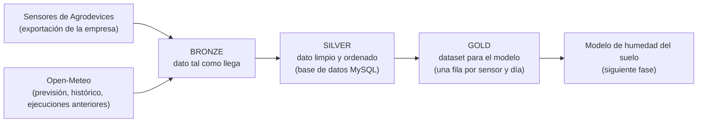

# Entrega 02 · Datos y preparación

**Proyecto:** plataforma de recomendaciones de riego explicables

## Contexto: de qué va mi proyecto

Soy becaria en Agrodevices, una empresa que fabrica sensores de humedad de suelo para agricultura. Mi proyecto es una plataforma que ayuda a un agrónomo a tomar decisiones sobre **cuánto regar, cuándo y por qué**, combinando los datos de esos sensores con la previsión meteorológica.

El proyecto tiene tres piezas que trabajan una detrás de otra:

1. **Un modelo de deep learning que predice** cómo estará la humedad del suelo en los próximos días.
2. **Un motor de reglas que decide** la recomendación de riego a partir de esa predicción. Es un cálculo normal, no una IA, para que sea siempre reproducible y automático.
3. **Un modelo de lenguaje que explica** el resultado de ese cálculo en un informe con gráficas y lenguaje natural, para que lo entienda un agrónomo o trabajador del campo.

---

## 1. Qué datos necesita mi producto

### 1.1. Qué representa una observación

Cada fila de mi dataset final representa **el estado de la humedad del suelo en un sensor concreto, a una profundidad concreta, de una parcela, en un día**. A esa fila le acompaña la meteorología de ese día, la de los días anteriores y la que se espera en los días siguientes (temperatura, pluviómetro, humedad ambiental...). Todo esto está repartido en 3 tablas diferentes de la base de datos. Por "día" entiendo la ventana de las 24 horas que termina a las 05:00, que es la hora a la que se guardan los datos con los que se calcula la recomendación.

Con esas filas, el modelo tendrá que aprender a responder a esta pregunta: *dada la humedad de hoy y el tiempo que viene, ¿cómo estará la humedad del suelo en los próximos 7 días?* Esa predicción es la que permitirá recomendar un riego no solo para hoy, sino también para toda la semana.

### 1.2. Datos imprescindibles y datos deseables

| | Dato | Para qué lo necesito |
|---|---|---|
| **Imprescindible** | Lecturas de humedad del suelo: fecha, valor, sensor, profundidad en centímetros, parcela y una marca que indica si la lectura es real o ha sido interpolada | Es lo que quiero predecir |
| **Imprescindible** | Lluvia diaria (mm) y evapotranspiración de referencia, ET0 (mm al día) | La lluvia añade agua al suelo; la ET0 estima cuánta agua se pierde por evaporación y por la planta |
| **Imprescindible** | Previsión de lluvia y de ET0 para los próximos días | Sin ella no se puede predecir el futuro |
| **Imprescindible** | Coordenadas y zona horaria de cada parcela | Para pedir la meteorología del sitio correcto y saber qué es "hoy" allí |
| Deseable | Temperatura, humedad relativa, viento | Complementan la explicación de la evaporación |
| Deseable | Datos de cultivo y suelo: cultivo, fecha de inicio del ciclo, tipo de suelo, capacidad de campo, punto de marchitez | Cambian cómo responde el suelo al agua. **Ahora mismo no los tengo** |
| Deseable | Riegos realmente aplicados | Un riego sube la humedad igual que la lluvia. **No tengo datos de riego todavía.** [COMPLETAR: la demo de la empresa muestra riegos programados; confirmar si existe un registro de riegos que pueda usar] |

### 1.3. Granularidad e histórico

- **Decido por días, pero guardo cada 15 minutos.** Los sensores miden cada 15 minutos (96 lecturas al día por sensor), mientras que la meteorología me llega por días. La recomendación es diaria y la semanal es, simplemente, la secuencia de 7 días, así que decido en unidades diarias. Guardo todas las lecturas de 15 minutos tal como llegan, sin resumirlas, y solo las convierto en variables diarias al construir el dataset final (el Gold).
- **Hora de corte.** La recomendación se calcula con los datos que se guardan a las 05:00 UTC. Por eso cada "día" es la ventana de las 24 horas que termina a las 05:00, tanto para lo que el modelo recibe como para lo que debe predecir. Si usara la media del día completo, estaría mirando lecturas de la tarde, que a las 05:00 todavía no existen, y el modelo parecería mejor de lo que realmente es. 
- **Histórico.** Lo ideal sería al menos una temporada completa, para que el modelo vea distintas estaciones. Dispongo de, al menos, unos 25.000 registros de varios sensores y parcelas. Si todos fueran lecturas de 15 minutos, equivaldrían a unos 260 días de sensor en total (25.000 / 96), repartidos entre todos los sensores, lo que sería poco para deep learning. [COMPLETAR: número exacto de sensores y de parcelas, fecha del primer y del último registro, si los 25.000 son lecturas de 15 minutos, y si cubren varias estaciones del año]
- **Histórico de previsiones.** Para entrenar necesito, además, saber qué se había previsto en cada momento del pasado. Open-Meteo lo ofrece (servicio de ejecuciones anteriores) a partir de enero de 2024 para la mayoría de modelos, y lo pido directamente a ellos cuando lo necesito, sin construir yo otro histórico. Si las lecturas de los sensores son anteriores a enero de 2024, esa parte inicial no tendrá previsiones reales asociadas. [COMPLETAR: fecha del primer registro de los sensores]
- **Para qué guardo el histórico.** Lo necesito para entrenar y evaluar el modelo. Una vez entrenado, para predecir ya no hace falta todo el histórico, sino solo una ventana reciente (por ejemplo, los últimos 7 días de humedad y de meteorología, que son las entradas del modelo). Aun así conservo el histórico por tres motivos: poder reentrenar el modelo cuando haya más datos y otras estaciones del año, poder comprobar si sus predicciones siguen acertando, y poder repetir los experimentos de este trabajo con los mismos datos. [COMPLETAR: cuánto tiempo conservaré las lecturas de 15 minutos, teniendo en cuenta el espacio de la base de datos]

---

## 2. Fuentes reales y viabilidad

Uso dos fuentes distintas: los sensores de Agrodevices y Open-Meteo para la meteorología.

### 2.1. Datos de sensores: Agrodevices

Estos datos son propiedad de Agrodevices, que fabrica y mantiene los sensores.

1. Cada sensor envía a la empresa una **trama hexadecimal**, es decir, una cadena de dígitos y letras que codifica la medida.
2. El servicio de la empresa **descodifica y normaliza** esa trama: comprueba el formato y que el valor esté dentro de un rango posible.
3. Si un valor sale erróneo, el sistema lo **interpola**: lo sustituye por una estimación calculada con las lecturas cercanas anteriores y posteriores. La lectura queda marcada como **`SMMi`**.
4. Las tramas originales se guardan en la empresa. **Yo trabajo con el valor ya normalizado**, no con la trama.

- **Acceso:** una exportación de los registros que la empresa me permite usar. [COMPLETAR: formato del archivo, columnas exactas y confirmación por escrito de que puedo usarlos]
- **Cobertura:** varios sensores y parcelas. [COMPLETAR: cuáles, y en qué periodo]
- **Actualización:** en el diseño de mi aplicación, los datos de los sensores se importan una vez al día, a las 05:00. [COMPLETAR]
- **Un dato que todavía no tengo confirmado:** qué variable exacta mide cada sensor y en qué unidad. Según la demo de la empresa, son sondas de tipo FDR (que miden la humedad del suelo) con sensores a 10, 20, 30 y 50 cm de profundidad, y envían sus datos cada 12 horas. [COMPLETAR: confirmar la variable, la unidad, las profundidades reales y la frecuencia de envío]

### 2.2. Datos meteorológicos: Open-Meteo

Open-Meteo es un servicio gratuito de datos meteorológicos, accesible por API, sin necesidad de clave. Uso tres de sus servicios:

| Servicio | Qué da | Cobertura y actualización |
|---|---|---|
| **Previsión** (`api.open-meteo.com/v1/forecast`) | Previsión diaria de hasta 16 días (por defecto, 7): temperaturas, humedad, viento, lluvia, ET0 y el código del tiempo | Se actualiza cada 1 a 12 horas, según el modelo. La ET0 la calcula con el método FAO-56 Penman-Monteith |
| **Histórico** (`archive-api.open-meteo.com/v1/archive`) | Lo que realmente ocurrió, reconstruido por modelos (lo que se llama un *reanálisis*). Fuentes: ERA5 (desde 1940, unos 25 km), ERA5-Land (desde 1950, unos 11 km) y el modelo IFS (desde 2017, unos 9 km) | ERA5 llega con unos 5 días de retraso, y los últimos días pueden revisarse. No incluye el índice UV ni la probabilidad de precipitación |
| **Ejecuciones anteriores** (*Previous Runs*) | Lo que el modelo **había previsto** días atrás: para un día concreto, lo previsto con 1, 2... hasta 7 días de antelación. **Solo ofrece valores por horas**, no diarios (lo comprobé con peticiones reales: pedir la ET0 o la lluvia diaria a este servicio da error), así que los sumo yo por días | La mayoría de modelos están archivados desde enero de 2024 |

**Cómo consigo las previsiones del pasado.** Uso el servicio de ejecuciones anteriores, descargado por horas y sumado por días: me da historia desde enero de 2024. No construyo otro histórico con mis propias capturas: la previsión de cada día se descarga igualmente para poder calcular la recomendación de ese día, y queda reflejada en ella. [COMPLETAR: comprobar que los valores de las ejecuciones anteriores se parecen a los de la previsión real, porque el modelo se entrena con unos y se usa con los otros]

### 2.3. Viabilidad y alternativas

- **Open-Meteo es viable:** no necesita registro ni clave, tiene un límite gratuito amplio (600 llamadas por minuto, 5.000 por hora y 10.000 por día) y mis dos parcelas de prueba están muy lejos de ese límite.
- **Alternativa si Open-Meteo no estuviera disponible:** descargar el reanálisis ERA5 directamente de Copernicus, la fuente de la que bebe Open-Meteo para el histórico. Para la previsión, otros servicios meteorológicos abiertos.
- **Alternativa si los datos de Agrodevices no estuvieran disponibles:** usar un conjunto público de humedad del suelo, como el de la red internacional ISMN, para poder demostrar el método. 

---

## 3. Uso, privacidad y datos personales

### 3.1. Condiciones de uso

- **Open-Meteo.** Los datos se ofrecen con licencia **CC BY 4.0**, es decir, se pueden usar citando la fuente. El uso gratuito es solo **no comercial**; entre los ejemplos que acepta están el contenido educativo y la investigación pública. Si Agrodevices lo desplegara como parte de su producto, tendría que contratar un plan.
- **Datos de Agrodevices.** Son propiedad de la empresa, que me autoriza a usarlos anonimizados para este trabajo académico.

### 3.2. Datos personales

Los datos de los sensores y la meteorología no son datos personales. Hay dos puntos donde sí aparece algo relacionado con personas:

- **Cuentas de usuario de la aplicación.** Se utilizan correo y contraseña inventados para asignarle la parcela de un usuario real. La contraseña no la guardo yo: la gestiona un servicio externo de acceso (Auth0).
- **Ubicación de las parcelas.** Las coordenadas de una parcela son públicas, pero aun y así, para limitar el riesgo de que se pueda acceder a su propietario: (1) el repositorio no incluye datos reales de clientes, solo una muestra pequeña y anonimizada; (2) para pedir la meteorología basta con una precisión de unos 1.000 metros, porque los modelos tienen una resolución de entre 9 y 25 km, así que redondearé las coordenadas antes de enviarlas a Open-Meteo, que puede registrar las coordenadas en sus servidores durante 90 días.
- **Minimización.** El dataset de entrenamiento (el Gold) no contiene ningún dato personal: ni emails, ni nombres, ni teléfonos, ni coordenadas exactas. Solo uso identificadores anónimos de parcela y de sensor.

---

## 4. Del dato bruto al dato utilizable

Organizo el trabajo en tres capas, de lo más crudo a lo más listo para usar:

### 4.1. Bronze: el dato tal como llega

Aquí **no se modifica nada**. Guardo cada dato exactamente como lo entrega su fuente, para poder repetir todo el proceso desde el principio.

- **Open-Meteo:** cada respuesta JSON se guarda sin tocar, junto con los parámetros de la petición y la fecha y hora de la descarga. Eso hace el proceso reproducible: con el mismo script se obtienen los mismos datos.
- **Agrodevices:** el archivo exportado, tal como me lo han entregado, con la información de los sensores en intervalos de 15 minutos.
- Estos archivos **no se suben al repositorio**, por tamaño y por privacidad. En el repositorio dejo solo una muestra pequeña y las instrucciones para generar el resto. [COMPLETAR: ruta de la muestra]

### 4.2. Silver: el dato limpio

Es el paso donde corrijo y ordeno. El resultado se guarda en las tablas de mi base de datos MySQL (`sensor_reading`, `historical_weather` y `forecast_data`), que ya diseñé y comprobé. Las transformaciones son:

| Qué | Cómo lo resuelvo |
|---|---|
| **Tipos y formatos** | Fechas y horas a un formato único (UTC); valores numéricos a decimal. |
| **Resolución de los sensores** | Las lecturas se guardan **a 15 minutos, sin resumir**. El resumen diario se hace después, en el Gold |
| **Marca de interpolación** | La marca `SMMi` / `SMM` se convierte en una columna de sí/no, `is_interpolated`. No cambio el valor: solo registro que fue interpolado |
| **Duplicados** | Una misma lectura no puede entrar dos veces: cada sensor tiene como máximo una lectura por instante. Al reimportar, no se duplica |
| **Nulos** | Reviso qué columnas tienen valores vacíos y decido caso por caso. [COMPLETAR: recuento real de nulos por columna] |
| **Unidades** | Compruebo que las de Open-Meteo son las esperadas (°C, km/h, mm) y confirmo la unidad de los sensores con la empresa |
| **Previsión y histórico, separados** | Las previsiones nunca se sobrescriben con el histórico: guardo cada captura con su antelación en días, para poder medir después los errores. El índice UV de la previsión no se arrastra al histórico, porque en el histórico no existe |
| **Previsiones pasadas** | Las ejecuciones anteriores llegan por horas y las sumo por días. Se guardan en `forecast_data`, con el origen y la antelación en días |
| **Revisiones del histórico** | Open-Meteo puede corregir los últimos días, así que cada día vuelvo a pedir una ventana reciente y actualizo esos valores |
| **Uniones (*joins*)** | Uno cada lectura de un sensor con su parcela y con la meteorología de esa parcela en ese día, teniendo en cuenta la zona horaria de la parcela |

Todavía no he cargado los 25.000 registros reales; en cuanto lo haga, completaré el recuento de problemas encontrados (duplicados, nulos, valores raros). [COMPLETAR: resultados del análisis de los datos reales]

### 4.3. Gold: el dataset que usará el modelo

**Qué significa cada fila:** un sensor, en un día (la ventana de 24 horas que termina a las 05:00), con su historial reciente y la meteorología pasada y prevista, y con la humedad de los 7 días siguientes como respuesta que el modelo debe aprender a predecir.

**Para qué se usa:** para entrenar y evaluar el modelo de predicción de humedad del suelo, que es la fase siguiente. Esta tabla es un diseño provisional: lo confirmaré al ver los datos reales.

| Columnas principales | Qué contienen |
|---|---|
| `plot_id`, `sensor_id`, `depth_cm`, `date` | Identifican la fila: parcela, sensor, profundidad y día. Son identificadores anónimos |
| `moisture_last`, `moisture_mean`, `moisture_min`, `moisture_max` | Humedad del suelo en esa ventana de 24 horas: el último valor (el de las 05:00, que es el estado a la hora de decidir), la media, el mínimo y el máximo de las lecturas de 15 minutos |
| `interpolated_share` | Proporción de lecturas de esa ventana que fueron interpoladas |
| `moisture_mean_lag_1` … `moisture_mean_lag_7` | La humedad media de cada una de las 7 ventanas anteriores |
| `rainMm`, `eto`, `tMedia` | Lluvia, ET0 y temperatura media de ese día y de los anteriores |
| `rain_forecast_d1` … `d7`, `eto_forecast_d1` … `d7` | Lluvia y ET0 que se preveían ese día para los 7 días siguientes |
| `day_of_year` | Día del año, para que el modelo capte las estaciones |
| Parámetros de parcela | Cultivo, tipo de suelo, etc., solo cuando existan |
| `target_moisture_d1` … `d7` | **Lo que se quiere predecir:** la humedad media de cada una de las 7 ventanas siguientes |

**Cómo se resumen las lecturas de 15 minutos.** Para cada sensor y cada ventana de 24 horas que termina a las 05:00, las 96 lecturas se resumen en cuatro valores: el último, la media, el mínimo y el máximo (cuartiles). La meteorología ya llega en valores diarios. Una misma fila sirve para las dos recomendaciones: la **diaria** usa la predicción del primer día y la **semanal**.

**Un conjunto de datos aparte.** El modelo de lenguaje necesitará otro conjunto de datos distinto, con ejemplos del tipo "resultado del motor → explicación". Se creará más adelante y no forma parte de esta entrega.

### 4.4. Cómo reproducirlo

El flujo completo se ejecuta en tres pasos: descargar y guardar el Bronze, limpiarlo hasta el Silver (la base de datos) y construir el Gold.

---

## 5. Riesgos y limitaciones

- **Datos que me faltan.** No tengo los riegos aplicados ni los parámetros del cultivo y del suelo, que influyen mucho en cómo cambia la humedad. Tampoco tengo todavía confirmado qué mide exactamente cada sensor ni en qué unidad. Además, las previsiones pasadas solo existen desde enero de 2024.
- **Cantidad de datos.** Unos 25.000 registros pueden ser pocos para deep learning: si fueran lecturas de 15 minutos, serían unos 260 días de sensor, y lo que cuenta no son las filas, sino los días distintos de información y que haya varias estaciones. Como regla orientativa, los modelos clásicos pueden funcionar con unos pocos miles de filas y el deep learning pide varios miles de ejemplos de varios sensores. Lo comprobaré con una curva de aprendizaje (entrenar con cantidades crecientes de datos y ver si el error sigue bajando). Si hay pocos datos, usaré un único modelo para todos los sensores, una red pequeña y compararé siempre con modelos sencillos.
- **Sesgos.** El histórico de Open-Meteo es un reanálisis con una resolución de 1 a 11 km, no una medición en la parcela, así que puede no reflejar el microclima real. Además, las lecturas interpoladas por la empresa pueden ocultar fallos de sensor: ya son un dato "estimado" y, en un mes, puede haber unos 130 sin que signifique un error, puede ser simplemente un momento sin cobertura.- **Dependencia de las fuentes.** Si Open-Meteo dejara de estar disponible usaría otra API emteorológica gratuita como AEMET; si fallaran los datos de Agrodevices, un conjunto público de humedad del suelo para demostrar el método.
- **Licencia.** El uso gratuito de Open-Meteo es solo no comercial: un despliegue comercial de Agrodevices requeriría un plan de pago.

---

## Referencias

- Open-Meteo, condiciones de uso y licencia: https://open-meteo.com/en/terms
- Open-Meteo, API de previsión: https://open-meteo.com/en/docs
- Open-Meteo, API de histórico (reanálisis): https://open-meteo.com/en/docs/historical-weather-api
- Open-Meteo, API de ejecuciones anteriores: https://open-meteo.com/en/docs/previous-runs-api
- FAO, balance hídrico del cultivo y ET0: https://www.fao.org/4/x0490e/x0490e0e.htm