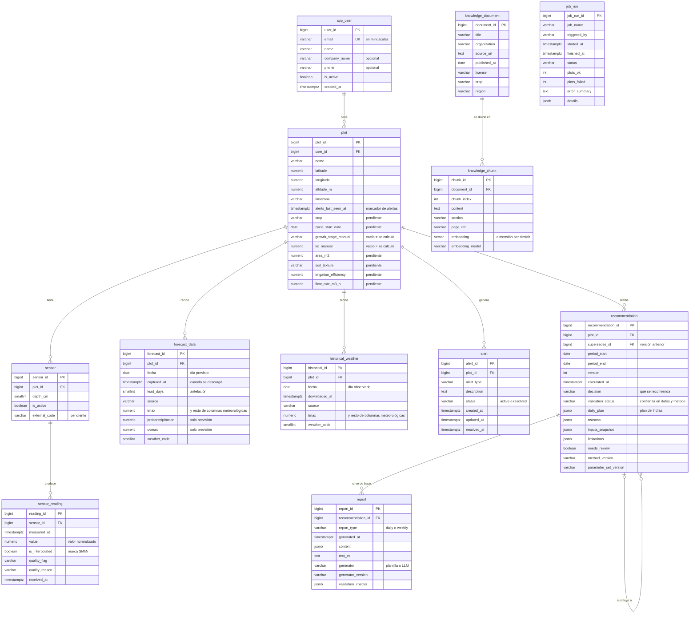

# Diagrama entidad-relación (ERD)

Muestra las tablas, sus claves y las relaciones. Para el detalle de cada columna, ver [base_de_datos.md](base_de_datos.md) (diccionario de datos) y [`sql/create_schema.sql`](../sql/create_schema.sql); el porqué de cada decisión está en [decisiones.md](decisiones.md). Si cambia el esquema, hay que actualizar los cuatro.

Cómo leer las relaciones: `||--o{` significa "uno a muchos" (una fila de la tabla de la izquierda se relaciona con muchas de la derecha); `|o--o{`, lo mismo pero donde el lado "uno" es opcional.

## Notas

- `plot` es el centro del esquema: casi todo cuelga de ella. Como cada parcela pertenece a un único usuario, los permisos se comprueban con `plot.user_id`.
- `job_run` no se relaciona con las demás tablas: es un registro de la operación de las tareas.
- `recommendation` es inmutable (un disparador impide modificarla o borrarla). Un recálculo crea otra fila con `version` + 1 que apunta a la anterior con `supersedes_id`.
- `report` solo se relaciona con `recommendation`: de ella obtiene la parcela y el periodo.
- Las tablas del RAG (`knowledge_document`, `knowledge_chunk`) son independientes del resto: no cuelgan de ninguna parcela.
- Unicidades: `forecast_data` (`plot_id`, `fecha`, `lead_days`, `source`), `historical_weather` (`plot_id`, `fecha`), `recommendation` (`plot_id`, `period_start`, `version`) y `report` (`recommendation_id`, `report_type`, `generator`, `generator_version`).
- Las columnas meteorológicas se escriben en minúsculas en la base (`tmax`, `rhmedia`...), aunque en la documentación conserven las mayúsculas de la empresa.
- Cada diagrama de Mermaid se dibuja directamente en GitHub y en muchos editores de Markdown.
